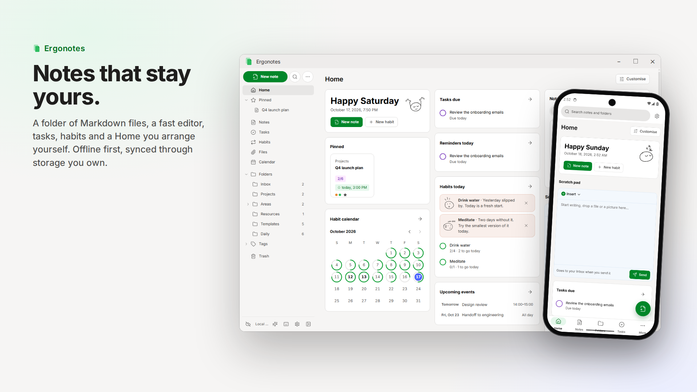
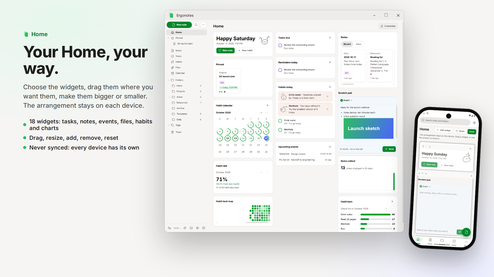
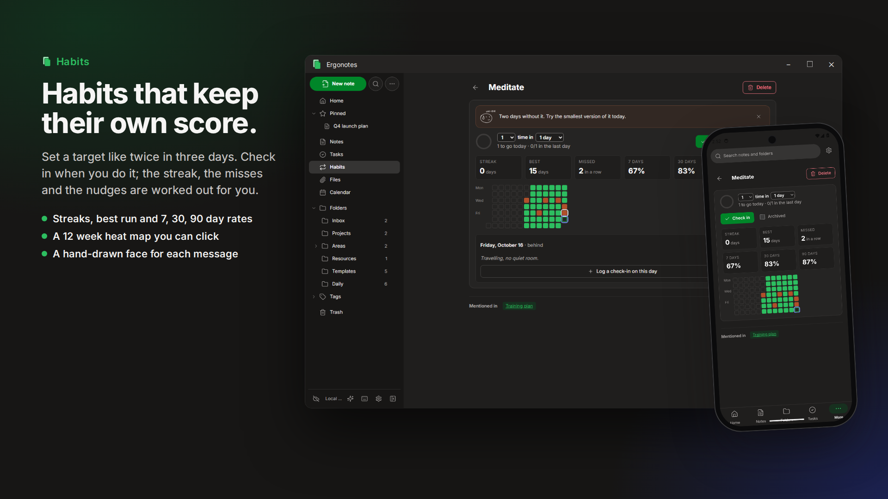
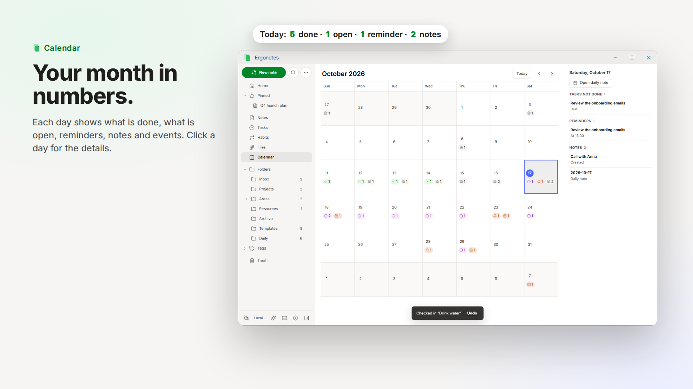
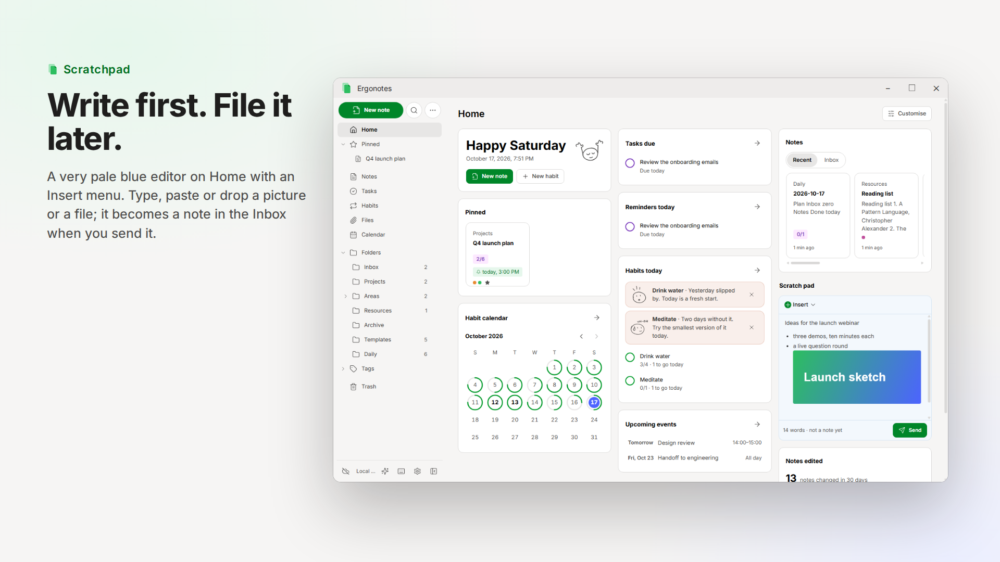
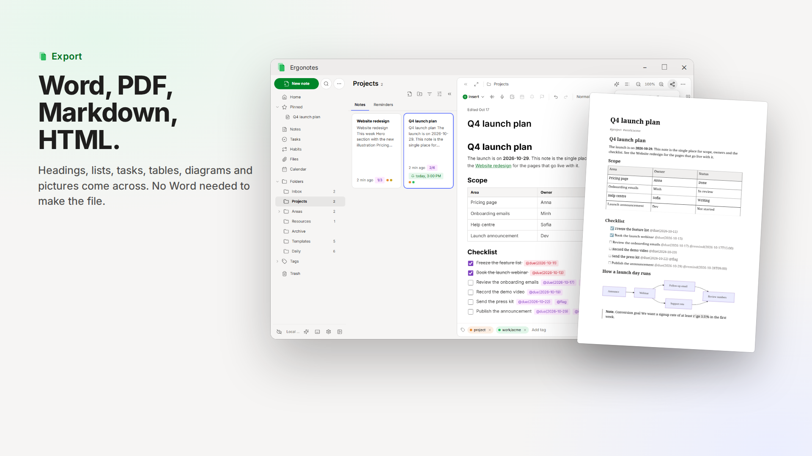
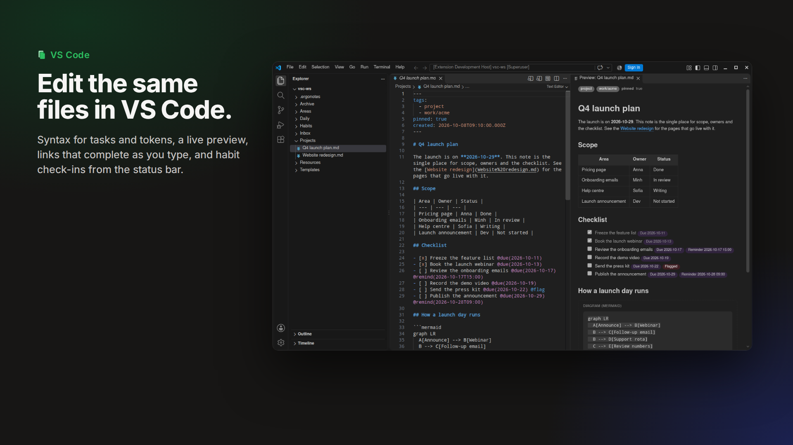
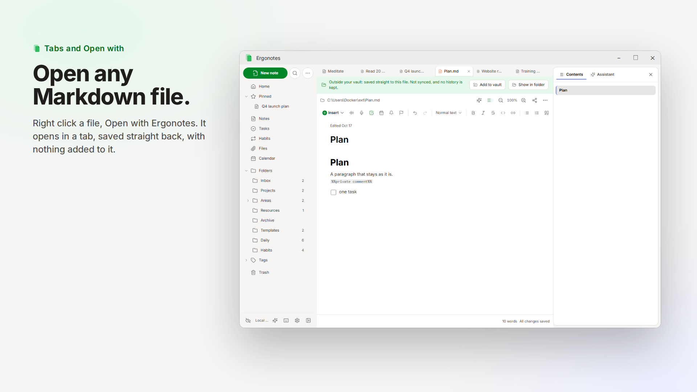
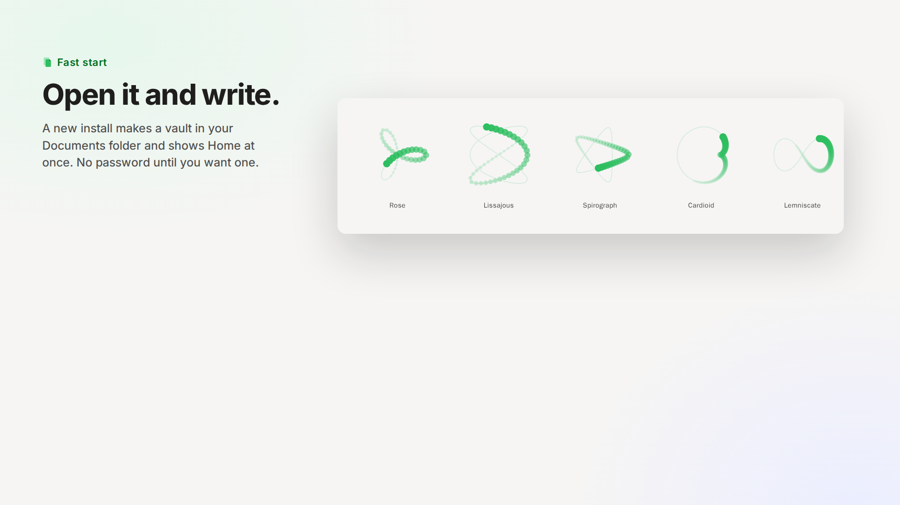
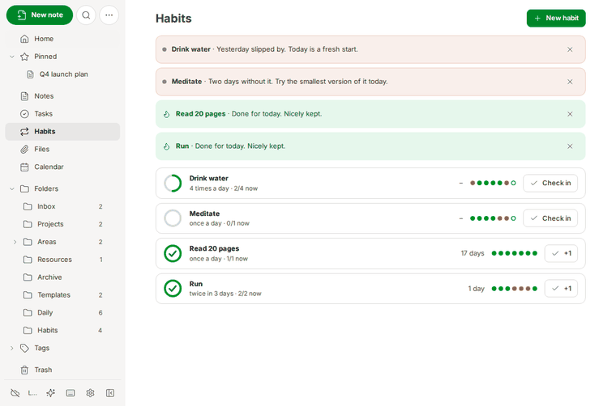

<p align="center">
  
</p>

<h1 align="center">Ergonotes</h1>

<p align="center"><b>Your notes, on every device, readable by nobody else.</b><br>
Offline-first notes in plain Markdown files, with a Notion-style editor, habits, tasks, a calendar, meeting recording and an optional AI assistant.
A free, open-source alternative to Obsidian and Evernote.</p>

<p align="center">
  <a href="https://ergonotes.vercel.app/demo/"><b>Try the live demo</b></a> ·
  <a href="https://ergonotes.vercel.app">Website</a> ·
  <a href="https://github.com/harrymadison297/Ergonotes/releases/latest">Download</a> ·
  <a href="#alternative-to-obsidian-and-evernote">Coming from Obsidian or Evernote?</a>
</p>

<p align="center">
  <a href="LICENSE"></a>
  <a href="https://github.com/harrymadison297/Ergonotes/releases/latest"></a>
  <a href="https://github.com/harrymadison297/Ergonotes/stargazers"></a>
  
</p>



> If Ergonotes is useful to you, a ★ at the top of the page helps other people find it.

## Why Ergonotes

- **Plain files, no lock-in.** A vault is a folder of Markdown files. Open it with any editor, put it in Git, delete the app and keep every note.
- **Offline first, private by design.** Everything works with no connection. Sync is optional and goes through storage you own (S3, WebDAV or a folder), sealed on your device before it leaves it. No account, no always-on server.
- **Notion-style writing on standard Markdown.** Type `/` for headings, toggles, tasks, tables, Mermaid diagrams and formulas; every block has a plain Markdown form.
- **More than notes.** Habits with streaks and a heat map, tasks with reminders, a calendar, a Home dashboard you arrange, and meeting recording with a transcript.
- **AI on your terms.** Next-word suggestions and a chat that edits your notes (you review every change), with your own OpenRouter, Anthropic or local server key. Notes marked private are never sent. The desktop app also runs a local MCP endpoint and ships a Claude Code plugin, so agents such as Claude Code can read, write and draw in your notes.
- **Everywhere you work.** Windows, Linux and Android apps, a web UI from the optional server peer, and a VS Code extension for the same files.

## Highlights

| | |
|---|---|
| **Write** | Slash menu, toggles, tables, Mermaid diagrams, KaTeX formulas, Excalidraw sketches and tabs; export to Markdown, HTML, PDF and Word. |
| **Record** | Audio of a call, pictures of the shared screen and a transcript in one folder, played back with the pictures marked on the timeline (docs/adr/0011). |
| **Assist** | Grey next-word suggestions and a chat that answers, edits and draws; the model is yours to configure, per job. |
| **Connect** | A local MCP endpoint in the desktop app (and on the server peer) with revocable tokens, and a Claude Code plugin with skills for writing, tags, drawing and more (docs/adr/0015). |
| **Track** | Habits that record only what you did; streaks, misses and 7, 30 and 90 day rates are worked out, never stored (docs/adr/0013, 0014). |
| **Organise** | PARA folders and an Inbox out of the box, `[[links]]` and backlinks, tags, pinned notes. |
| **Code** | `apps/vscode`: syntax, preview, links, snippets and habit check-ins for the same vault. |

## Alternative to Obsidian and Evernote

Ergonotes is for people who like **Obsidian**'s files-in-a-folder honesty or **Evernote**'s "everything in one place" feel, and want the two together, free and open source.

| | Ergonotes | Obsidian | Evernote |
|---|---|---|---|
| Notes are stored as | plain `.md` files in a folder | plain `.md` files in a folder | the service's own database |
| Account needed | no | no (for local use) | yes |
| Source | Apache-2.0, open source | closed source, free for personal use | closed source |
| Sync | end-to-end encrypted through your own S3, WebDAV or folder | paid Obsidian Sync, or your own tools | the service's cloud |
| Tasks and calendar | built in | checkboxes; more through community plugins | built in |
| Habit tracking | built in, with streaks and a heat map | through community plugins | no |
| Plugins and themes | none yet | a very large ecosystem | no |

Ergonotes also has meeting recording with a transcript, an optional AI assistant on your own key, and an MCP endpoint for agents; compare those with the other tools' own documentation, as they change quickly.

**Where the others are ahead, honestly:** Obsidian has a huge plugin and theme ecosystem, a graph view, Canvas and years of polish. Evernote has a web clipper, shared notebooks and team features. Ergonotes is young: it has no plugin system, no web clipper, no real-time collaboration and no macOS build yet.

### Moving from Obsidian

An Obsidian vault is already a folder of Markdown, and Ergonotes works on such a folder directly (docs/adr/0010):

1. Copy your vault first, as you would before trying any new tool.
2. In the desktop or Android app choose that folder in *Settings* (or put the files in `Documents/Ergonotes`).
3. Frontmatter `tags`, `[[wiki links]]` and folders are read as they are. What Ergonotes does not understand (`![[embeds]]`, `%%comments%%`, callouts, Dataview and Canvas blocks, odd list markers) is kept byte for byte and never rewritten.

Plugins do not carry over, and there is no graph view yet.

### Moving from Evernote

1. In Evernote, export your notebooks as `.enex` files.
2. `.enex` import is not built in yet (see docs/implementation-notes.md). Convert the export to Markdown with a converter such as [evernote2md](https://github.com/wormi4ok/evernote2md), which writes one `.md` file per note and keeps the attachments.
3. Put the resulting folder in your vault. Every note is a file, so the notebooks become folders and the tags become frontmatter.

## In detail

| | |
|---|---|
| **Start at once** | A new install on Windows, Linux or Android makes a vault in your Documents folder and shows Home straight away, with no set-up screen and no password until you want one (docs/adr/0012). A running curve shows while the app starts and while a big folder is read. |
| **Scratchpad** | A very pale blue note on Home that is not a note yet: it uses the note editor with only an Insert button, keeps its draft on the device, takes dropped or pasted pictures and files, and becomes a note in the Inbox when you send it. |
| **Habits** | A habit is a file in the hidden `.habits/` folder with a target such as twice in three days; it is not a note and has a page of its own (docs/adr/0014). Check in when you do it; the streak, the misses, the 7, 30 and 90 day rates, a 12 week heat map and the messages, each with a hand-drawn face, are worked out, never stored (docs/adr/0013). Mention a habit in any note with `@`. |
| **Home** | A dashboard of widgets you arrange on each device (never synced): notes, scratch pad, tasks due, reminders, events, files, tags, and habit widgets with a ring on each day, the month's rate against last month, check-ins per habit, streaks and a year heat map, plus charts of notes edited and tasks done. |
| **Calendar** | Each day shows counts: tasks done and open, reminders, notes, events. |
| **Tabs and Open with** | Notes open in tabs (Ctrl+click, Ctrl+W, Ctrl+Shift+T). Right click a Markdown file anywhere, *Open with Ergonotes*: it is edited in place and nothing is added to it. |
| **Export** | Markdown, HTML, PDF and Word (`.docx`, made in the app). |
| **VS Code** | `apps/vscode` is an extension to read and edit the same files in VS Code: syntax, a preview, links, snippets and habit check-ins. |

<table>
<tr><td colspan="2"></td></tr>
<tr><td></td><td></td></tr>
<tr><td></td><td></td></tr>
<tr><td></td><td></td></tr>
<tr><td colspan="2"></td></tr>
</table>

The raw screenshots (real Windows and Android apps, light and dark) are in [docs/media/screens](docs/media/screens).



| | |
|---|---|
| **Android, Windows, Linux** | Tauri 2 apps. Notes are files in a folder on the device (default `Documents/Ergonotes`, changed in Settings or from the first-run note); sync is optional. |
| **Web** | The same UI served by the optional Linux *server peer* (no offline mode). |
| **Sync** | End-to-end encrypted objects in an S3-compatible bucket, WebDAV share, or plain folder. |
| **Agents** | MCP at `http://127.0.0.1:7424/mcp` while the desktop app runs (tray and start-with-system optional), or over HTTP on the server peer; revocable tokens; Claude Code plugin in `plugins/ergonotes/`. |
| **Assistant** | Optional chat that answers, writes, edits and draws in your notes, and a next-words suggestion. Bring your own OpenRouter or Anthropic key; off until you add one; notes marked private are never sent. |

## Quick start

```sh
# one machine, web UI on http://localhost:8080
npm install
npm -w @ergonotes/app run build
ERGONOTES_DATA=./data node apps/server/src/main.ts
```

No Node on the host? `tools/n <command>` runs any command in a Node container.

Open the page, choose a password (12+ characters, **it cannot be recovered**) and write. (The desktop and Android apps need no password to start; *Settings → Security* adds one.) The notes are Markdown files in
`./data/vault` (set `ERGONOTES_VAULT_DIR` to use a folder you already have).
To sync devices: *Settings → Sync & storage*, enter an S3/WebDAV location, then on the other device choose
*Join existing* with the same location and password.

## Server peer (Linux)

```sh
tools/bundle-server.sh                 # dist/server/server.mjs + web build
node dist/server/server.mjs            # PORT, HOST, ERGONOTES_DATA, ERGONOTES_VAULT_DIR, ERGONOTES_WEB
```

* Serves HTTPS-only (or localhost: a connection from this machine). Put it behind Caddy/nginx for TLS and set
  `ERGONOTES_TRUST_PROXY=1` so the secure cookie and the sign-in rate limit use the proxy's view of the client; or set
  `ERGONOTES_ALLOW_INSECURE=1` on a trusted LAN (plain HTTP: the password crosses the network in clear).
* On a server reachable by strangers set `ERGONOTES_SETUP_TOKEN` before first run, or the first visitor can claim it.
* Folder storage chosen in the web UI has to be inside the data directory unless `ERGONOTES_FOLDER_STORE_ROOT` says otherwise.
* The vault is unlocked at the first sign-in and the key stays in memory. `ERGONOTES_PASSWORD` unlocks at start-up
  (unattended restarts) at the cost of keeping the password in the environment.
* The vault is a folder of Markdown files, `$ERGONOTES_VAULT_DIR` (default `$ERGONOTES_DATA/vault`): put files there and they are notes; edit them with any other program and the app picks the change up within seconds.
* Agents on the desktop app: the endpoint is on while the app runs (`http://127.0.0.1:7424/mcp`; *Settings → Agents (MCP)*
  changes the port, shows the tokens, and offers a tray icon and start-with-system). For Claude Code install the plugin,
  which finds the address and the token by itself and brings the skills:
  `claude plugin marketplace add harrymadison297/Ergonotes` then `claude plugin install ergonotes@ergonotes`.
  Without the plugin: `claude mcp add --transport http ergonotes http://127.0.0.1:7424/mcp --header "Authorization: Bearer <token>"`.
* Agents on the server peer: *Settings → Agents (MCP)* creates a token; point any MCP client at
  `https://your-host/mcp` with `Authorization: Bearer <token>`.
* Tools: `search_notes`, `list_recent`, `read_note`, `get_links`, `read_record`, `create_note`, `append_to_note`, `replace_text`,
  `insert_after_heading`, `update_note`, `rename_note`, `add_tags`, `move_note`, `list_folders`, `list_tags`, `list_tasks`,
  `complete_task`, `daily_note`; on the desktop also `draw`, `insert_diagram`, `read_drawing`, `search_libraries`,
  `browse_library`, `import_library_item`. Notes marked private are invisible to agents. The skill that teaches an agent to
  use them without the plugin is `docs/agents/ergonotes-skill/SKILL.md` (also a download button).
* Assistant: *Settings → AI* holds any number of connections: OpenRouter or Anthropic keys, or the address of your own
  OpenAI-compatible server such as Ollama (`http://localhost:11434`; key optional). Pick the chat model (also from the
  chat) and a separate suggestion model, each on any connection. Keys are stored encrypted in the vault. On the server the
  key stays on the server and the browser streams through `/api/ai/stream`. The right sidebar holds the note's contents
  and the assistant (history, `@` to attach notes and files, Ask/Edit mode, its thinking shown, thinking level per job). See ADR 0008.

## Building the apps

The toolchain (Node, Rust + Windows/Android targets, JDK, Android SDK/NDK, NSIS) is a Docker image:

```sh
docker build -t ergonotes-builder tools/builder     # once, ~16 GB
tools/release.sh                                    # Windows installer + portable zip, Linux .deb + AppImage, server bundle, VS Code extension -> dist/release
tools/build-android.sh                              # signed release APK -> dist/release
```

Android releases are signed with `KEYSTORE`/`KEYSTORE_PASS`/`KEY_ALIAS` when set, otherwise with a throw-away key.

### About the installers and "unknown publisher"

The Windows installer and the programs in it name their publisher (*Ergonotes*) in their file properties and in Apps & features,
but they are **not code-signed**: signing needs a certificate that a certificate authority issues to a verified person or
company, and Windows SmartScreen only shows a publisher name for a signed file. Until then Windows may ask you to confirm
(*More info*, then *Run anyway*). Every release lists a SHA-256 checksum for each file in `SHA256SUMS`, and the whole source is here.
To sign a build yourself, set `bundle.windows.certificateThumbprint` (or a `signCommand`) in `apps/desktop/src-tauri/tauri.conf.json`.

## Develop & test

```sh
tools/n npm test                      # core (merge, sync simulation, vault, AI) + server + MCP
OPENROUTER_API_KEY=… tools/n npx vitest run packages/core/test/ai-live.test.ts   # optional: the real provider
tools/n npm run typecheck
# end-to-end in real browsers / VMs: packages/app/e2e (smoke.mjs, sync.mjs, device.mjs)
```

`packages/core` has no UI or platform code: graph, merge, replica/sync, crypto and the Vault API.
`packages/app` is the React UI; `apps/server` the server peer; `apps/desktop` the Tauri shell.

## Design

`CONTEXT.md` is the glossary; `docs/adr/` records the decisions (per-note commit graph instead of CRDT, Markdown
source format, passive Store, password-wrapped master key, ...). `docs/issues/` holds the milestone breakdown.
`docs/implementation-notes.md` lists where the implementation deviates from the ADRs and what is not done yet.

## Brand and UI

Colours, type, components and voice are in [docs/brand-guidelines.md](docs/brand-guidelines.md); the CSS tokens that implement them are in `packages/app/src/styles/tokens.css`.

## Website and demo

`apps/site` is the landing page (React, Vite, `motion`); the demo at `/demo/` is the real app built with `vite build --mode demo`, which opens a made-up vault (`packages/app/src/demo`) in memory with no server. `npm run build:site` builds both into `apps/site/dist`; `vercel.json` makes Vercel do the same on every push.

## License

[Apache License 2.0](LICENSE), see also [NOTICE](NOTICE).
